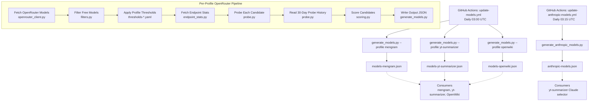
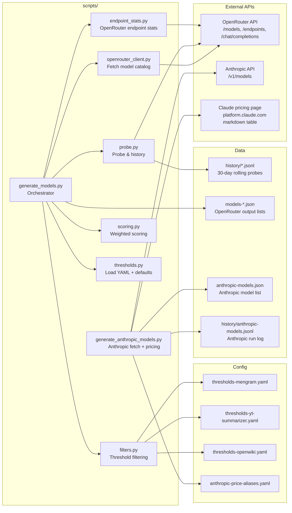
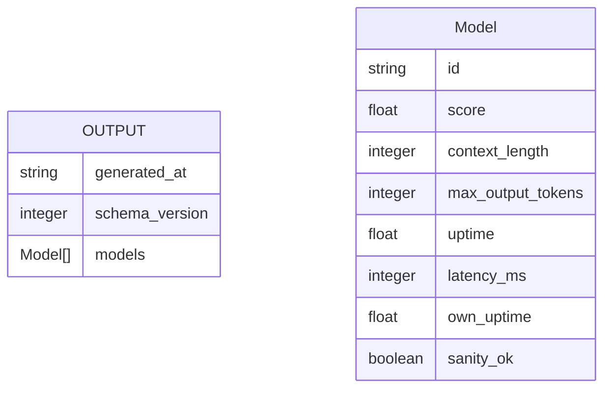

# Architecture Overview

This repository implements a **daily-refreshed, scored model list pipeline** for OpenRouter free models, plus a separate Anthropic model list pipeline. Both run on scheduled GitHub Actions workflows and produce JSON files that consumers point their `model_list_url` at.

## High-Level Data Flow

**Caption:** Scheduled workflows run per-profile generation and the Anthropic fetch; each OpenRouter profile runs the full filter→probe→score pipeline; outputs are consumed by downstream tools.

## Component Architecture

**Caption:** Scripts, config, data, and external API dependencies for both pipelines.

## Pipeline Stages (Per Profile)

| Stage | Script | Input | Output | Key Logic |
|-------|--------|-------|--------|-----------|
| 1. Fetch catalog | `openrouter_client.py` | `OPENROUTER_API_KEY` | `List[Model]` | `GET /api/v1/models` |
| 2. Filter free | `filters.py::is_free` | All models | Free models | `pricing.prompt == "0" && pricing.completion == "0"` |
| 3. Apply thresholds | `filters.py::filter_candidates` | Free models + thresholds | Candidates | Hard floor `min_param_b`; buffered `min_context_length`, `min_max_output_tokens`; `allowlist`/`hardallowlist`; `require_structured_output`, `require_tools`; relax `buffer_pct` to meet `min_candidate_pool` |
| 4. Endpoint stats | `endpoint_stats.py` | Candidate IDs | `uptime`, `latency_p50` (avg over free endpoints) | `GET /models/{id}/endpoints`, average free endpoints; fallback `0.5`/`None` on failure |
| 5. Probe | `probe.py` | Candidate IDs | `success`, `latency_ms` (recorded to history) | 1-token completion via OpenAI client; append to `history/<model>.jsonl` (30-day rolling) |
| 6. Own uptime | `probe.py::compute_uptime` | 30-day history | `own_uptime` (0-1) | `<3 samples` → `0.5` neutral; else success rate |
| 7. Post-probe filter | `scoring.py::passes_post_probe_filters` | OR uptime/latency + thresholds | Pass/fail | Optional `min_uptime`, `max_latency_ms` |
| 8. Score | `scoring.py::compute_score` | Model, OR stats, max context, own uptime | `score` (0-1) | `0.6*or_uptime + 0.3*latency_norm + 0.1*capability_norm` × `own_uptime`; latency capped at 5s; capability = `context_length / max_context` |
| 9. Sort & write | `generate_models.py` | Scored list | `models-<profile>.json` | Descending score; schema v2 |

## Anthropic Pipeline

The Anthropic pipeline (`scripts/generate_anthropic_models.py`) is a separate daily job that enriches the Anthropic API model list with pricing scraped from the public Claude pricing page.

**Stages:**
1. **Fetch models** — paginated `GET https://api.anthropic.com/v1/models`, filtered to `type == "model"`, sorted by id.
2. **Fetch pricing** — `GET https://platform.claude.com/docs/en/about-claude/pricing` with `Accept: text/markdown` header.
3. **Parse pricing table** — match the documented header; parse five price fields per row (input, cache_write_5m, cache_write_1h, cache_read, output) in USD per MTok.
4. **Alias resolution** — read `anthropic-price-aliases.yaml`; alias matches take priority over direct slug matches.
5. **Join prices** — map pricing rows onto API model ids by slug or alias.
6. **Long-context tiers** — detect rows with `(for prompts over N tokens)` suffix and attach `pricing_long_context`.
7. **Output** — write `anthropic-models.json` and append a JSONL entry to `history/anthropic-models.jsonl`.

**Fail-closed:** On any pricing problem — missing table, schema change, unparseable price, zero/negative price, or an unmatched model id — the script raises `PricingError`, prints to stderr, exits with code 1, and leaves `anthropic-models.json` untouched. The last known-good committed file is preserved.

**Authentication:** Requires `ANTHROPIC_API_KEY`, sent as the `x-api-key` header on the models API request.

## Data Model (Output Schema)

### OpenRouter output (`models-<profile>.json`, schema v2)

**Caption:** Output JSON schema (v2). `generated_at` is ISO 8601 UTC; `score` rounded to 4 decimals; `latency_ms` null if no free endpoint latency.

### Anthropic output (`anthropic-models.json`)

Each model object from the Anthropic API is enriched with a `pricing` object (five price fields) and optionally a `pricing_long_context` object (threshold + prices for long-context tier).

## Profiles

Three independent profiles, each with its own thresholds and output:

| Profile | Output File | Thresholds File | Use Case |
|---------|-------------|-----------------|----------|
| `mengram` | `models-mengram.json` | `thresholds-mengram.yaml` | Knowledge extraction: ≥28B params, ≥40k context, ≥8k output, structured output required |
| `yt-summarizer` | `models-yt-summarizer.json` | `thresholds-yt-summarizer.yaml` | YouTube transcript summarization: ≥14B params, ≥32k context, ≥2k output, no structured output |
| `openwiki` | `models-openwiki.json` | `thresholds-openwiki.yaml` | Agentic doc generation: ≥70B params, ≥128k context, ≥16k output, tool-calling required |

See [Profiles & Thresholds](../configuration/profiles.md) for details.

## External Dependencies

- **OpenRouter API** — Model catalog (`/models`), endpoint stats (`/models/{id}/endpoints`), completion endpoint for probes. Requires `OPENROUTER_API_KEY`.
- **Anthropic API** — Daily model list fetch (`/v1/models`). Requires `ANTHROPIC_API_KEY` (`x-api-key` header).
- **Claude pricing page** — Public markdown pricing table at `platform.claude.com`; scraped with `Accept: text/markdown`. No auth required.

## Deployment

- **Runtime**: GitHub Actions (`ubuntu-latest`, Python 3.11+, `uv`)
- **Schedule**:
  - `update-models.yml`: Daily 03:00 UTC — generates all three OpenRouter profile lists
  - `update-anthropic-models.yml`: Daily 03:15 UTC — offset to avoid conflict with the OpenRouter job
  - `openwiki-update.yaml`: Every other Saturday 05:00 UTC (ISO week parity gated) — consumes `models-openwiki.json`
- **Concurrency**: Both model-update jobs share the `update-model-lists` concurrency group to prevent overlapping runs.
- **Artifacts**: Committed JSON files and history logs; pull requests created on change with automatic merge attempted.
- **History**: `history/` directory committed daily (30-day rolling probe logs for OpenRouter; append-only run log for Anthropic).

## Related Pages

- [Model Generation Workflow](../workflows/generate-models.md) — Step-by-step pipeline walkthrough
- [Anthropic Model List Generation Workflow](../workflows/generate-anthropic-models.md) — Anthropic pipeline details
- [Profiles & Thresholds](../configuration/profiles.md) — Threshold configs and profile details
- [GitHub Actions](../operations/github-actions.md) — Workflow definitions and scheduling
- [Source Map](../source-map.md) — File-to-concept mapping
