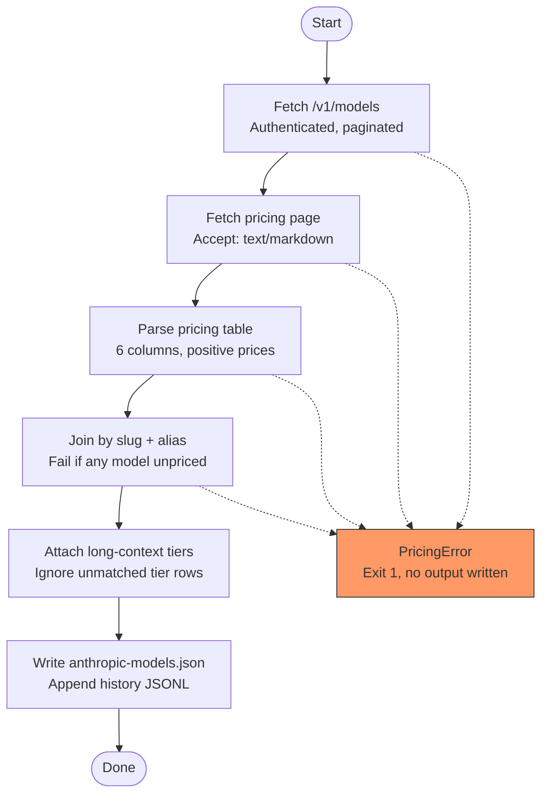

The Anthropic API integration is implemented in `scripts/generate_anthropic_models.py`. It fetches the list of available Claude models from the Anthropic Models API and combines it with pricing data scraped from the official Claude pricing page to produce `anthropic-models.json`, which is used throughout the system for cost calculations.

## Control Flow



**Caption:** End-to-end flow of the Anthropic model generation script. Any pricing problem branches to Fail, which exits non-zero without writing output.

## API Models Endpoint

The integration retrieves model metadata by making authenticated requests to `https://api.anthropic.com/v1/models`. It uses:

- Header `x-api-key` with the API key from the execution environment
- Header `anthropic-version: 2023-06-01`
- Query parameter `limit: 1000`

It follows the `has_more` and `last_id` fields to iterate through all pages, sending `after_id` (the previous page's `last_id`) to fetch the next page, and filters results to objects where `type == "model"`. The final model list is sorted by `id`.

## Pricing Page Scraping

Pricing data is obtained by requesting `https://platform.claude.com/docs/en/about-claude/pricing` with the header `Accept: text/markdown` to receive the page in Markdown format. The integration locates the first table whose header matches (after whitespace normalization):

```
| Model | Base input tokens | 5m cache writes | 1h cache writes | Cache hits and refreshes | Output tokens |
```

Each subsequent row is parsed into six cells. The first cell is the model name as shown on the pricing page; the remaining five cells contain prices in formats like `$0.25 / MTok<sup>1</sup>`. Prices are extracted via regex `\$\s*([0-9]+(?:\.[0-9]+)?)\s*/\s*MTok` and converted to `float`. A `PricingError` is raised if the header is missing, a row has an incorrect number of columns, any price fails to parse, or any price is zero or negative.

## Model ID to Pricing Row Matching

The integration matches API model IDs to pricing table rows using a two-step process:

1. **Slugification**: Pricing page model names are converted to slugs via `slugify`: lowercase, replace spaces and periods with hyphens, remove non-alphanumeric/hyphen characters, collapse multiple hyphens, and trim leading/trailing hyphens.
2. **Alias Resolution**: Before attempting a direct slug match, the integration checks `anthropic-price-aliases.yaml` for alternative model ID mappings. Alias entries take precedence over slug matches.

For each pricing row, the resolved model IDs (from aliases or slug) are assigned the row's prices. If any API model ID from the fetch step lacks a price after processing all rows, the integration raises a `PricingError` listing the missing IDs and aborts without writing output (fail-closed behavior).

## Long-Context Tiers

Some pricing page rows include a suffix like `(for prompts over 200000 tokens)` in the model name cell. The integration extracts the threshold value using `\(\s*for prompts over ([0-9][0-9,]*) tokens\s*\)`. When present, the same prices are combined with the threshold as `threshold_input_tokens` for the matched model ID(s). A tier row is joined like a base row: alias first, then the slug of the name without the parenthesis. Tier rows that map to no API model ID are ignored.

## Output Format

On successful completion, the integration writes a JSON **array** to `anthropic-models.json`. Each element is a model object from the API (including `id`, `display_name`, `type`, `created_at`, and capabilities) enriched with:

- `pricing` — an object with `input`, `cache_write_5m`, `cache_write_1h`, `cache_read`, `output` (all floats, dollars per million tokens)
- Optionally `pricing_long_context` — an object with `threshold_input_tokens` (integer) plus the same five price fields, present only for models the pricing page tiers by prompt length

Example entry:

```json
{
  "id": "claude-haiku-5-5",
  "display_name": "Claude Haiku 5.5",
  "type": "model",
  "created_at": "2026-01-01T00:00:00Z",
  "pricing": {
    "input": 0.1,
    "cache_write_5m": 0.125,
    "cache_write_1h": 0.2,
    "cache_read": 0.01,
    "output": 0.5
  },
  "pricing_long_context": {
    "threshold_input_tokens": 100000,
    "input": 0.5,
    "cache_write_5m": 0.625,
    "cache_write_1h": 1.0,
    "cache_read": 0.05,
    "output": 2.5
  }
}
```

## History

Additionally, it appends a JSON line to `history/anthropic-models.jsonl` containing `{"timestamp": now, "models": models}`, where `timestamp` is an ISO 8601 UTC string (e.g. `2026-10-10T00:00:00Z`) and `models` is the full enriched model array. The line is written in compact JSON form. If any step fails, no output files are written and the existing `anthropic-models.json` remains unchanged, preserving the last known-good dataset.

## Fail-Closed Behavior

The script fails closed (non-zero exit, no output written) on any of:

- The pricing table header not found or its column schema changed
- A row with an incorrect number of columns
- A price that fails to parse
- A price of zero or negative
- Any API model ID that lacks a price after the join

On `PricingError`, the script prints an error to stderr, returns exit code 1, and writes nothing: `anthropic-models.json` and `history/anthropic-models.jsonl` are both left untouched. This prevents propagating corrupted pricing data to downstream cost calculations.

## Operational Context

This integration is executed on a schedule by GitHub Actions (see workflows/generate-anthropic-models.md). The scheduled workflow runs on cron `15 3 * * *` (daily 03:15 UTC, offset to avoid conflict with the OpenRouter update at 03:00) and supports manual `workflow_dispatch` triggers. It runs `uv run scripts/generate_anthropic_models.py`, which requires the `ANTHROPIC_API_KEY` environment variable, read via `os.environ["ANTHROPIC_API_KEY"]` (a missing key raises `KeyError`).

The script's `generate()` function accepts injected `fetch_models_fn` and `fetch_pricing_fn` callables, which the test suite uses to exercise the join and output logic without network access.

On success, a pull request is created against branch `automation/update-anthropic-models` with changes to `anthropic-models.json` and `history/anthropic-models.jsonl`, and an immediate merge is attempted; if the merge is refused, the PR is left open for the fleet-timed autobrewer to merge.
